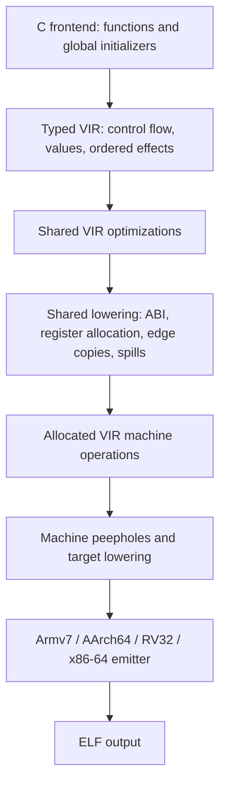
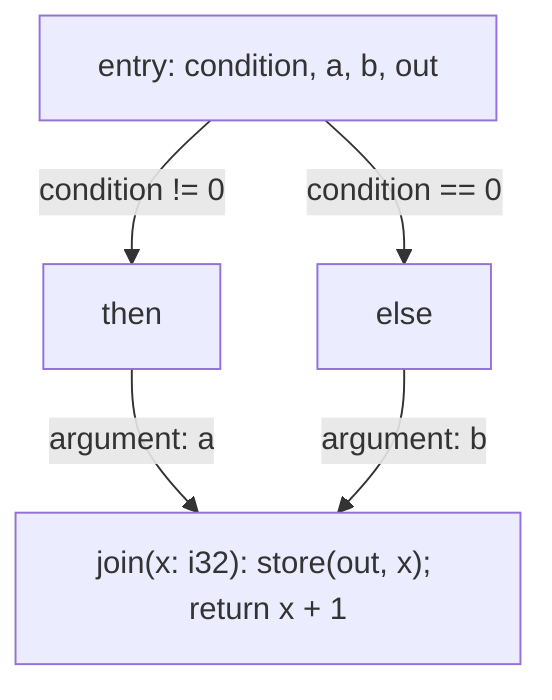
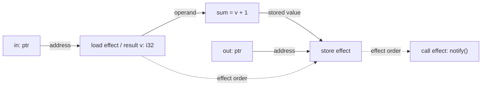

# VIR — Value Intermediate Representation

VIR (Value Intermediate Representation) is shecc's target-independent, typed
intermediate representation. It uses static single assignment (SSA): each
scalar value has one definition, even when a source variable is assigned more
than once. Its organizing rule is:

> CFG for control, graphs for values, order for effects.

## Pipeline

Every function and global initializer is constructed as VIR. The compiler
uses one pipeline for Armv7, AArch64, RV32, and x86-64:



The compiler optimizes and verifies each function's graph as soon as the
function is parsed, then copies the live graph into a compact arena; the global
initializer graph follows at the end of parsing. At O0, the compiler skips
optional transformations but still verifies.

VIR owns values, control flow, and ordered effects. The shared lowerer assigns
physical registers, resolves edge copies, handles ABI boundaries, and allocates
spill storage. Its output is VIR's machine layer: `vir_mop_t` machine
operations, in machine blocks, that all four emitters consume. Function graphs
and analysis tables are released after lowering; the machine operations carry
every operand emission needs.

Reachability follows calls and function addresses from `main` and global
initialization. Used functions must have definitions unless dynamic linking
can resolve them. Unsupported source forms and invalid graphs produce
compiler diagnostics.

## Design: control, values, and effects

A function graph (`vir_function_t`) combines three related structures:

| Structure | Purpose | Main representation |
| --- | --- | --- |
| Control-flow graph (CFG) | Select which blocks execute and carry values between them. | `vir_block_t`, `vir_edge_t`, block parameters, and terminators |
| Value graph | Connect typed definitions to their operands and uses. | `vir_value_t`, operand links, and reverse `vir_use_t` links |
| Ordered effects | Preserve the order of memory accesses, calls, and volatile operations within each block. | `vir_effect_t`, with links to addresses, arguments, and results |

These structures share values. A load or non-void call has both an effect entry
and a result value; a store consumes an address and a value but defines no
result. Pure computations have operand dependencies and a defining block, but
no entry in the effect list. A block ends with a jump, conditional branch, or
return. Effect order between blocks follows the executed CFG path.

### Example: a value merged across branches

Consider a function that selects one of two inputs, stores it, and returns its
successor:

```c
int select_and_store(int condition, int a, int b, int *out)
{
    int selected;
    if (condition)
        selected = a;
    else
        selected = b;
    *out = selected;
    return selected + 1;
}
```

The following schematic shows its control flow before CFG simplification.
Names are explanatory labels, rather than literal VIR dump syntax.



`x` is a block parameter: the incoming edge supplies either `a` or `b`.
The parameter is defined once at the join, and each edge argument must match
its type and position. This expresses the same merge as an SSA phi instruction.
During lowering, each edge's arguments become a parallel copy into the
locations assigned to the destination parameters. Copies whose source and
destination already share a location require no machine instruction.

### Example: value dependencies and effect order

Within a block, the value graph and effect list describe different constraints.
For `*out = *in + 1; notify();`, the load defines a value used by the addition,
and the store consumes the addition's result. The call follows the store in
the effect list:



Solid arrows show value dependencies; dashed arrows show effect order.
The addition belongs to the value graph, while the load, store, and call also
belong to the block's effect list. This lets pure-value optimizations follow
operand links while memory transformations respect explicit effect boundaries.

## Rationale

VIR is SSA for scalar values: each value is defined once, and the verifier
checks dominance and use-def consistency. Its design choices concern how
merges, effects, and ABI information are represented alongside those values.

### SSA representation choices

- **Block parameters instead of phi instructions.** A jump edge carries
  arguments and the receiving block declares parameters (`edge->args`,
  `vir_block_add_param()`), as in MLIR and Cranelift. Adding, removing,
  redirecting (`vir_edge_redirect()`) or splitting (`vir_edge_split()`) an
  edge moves its arguments with it, so there is no phi operand list to keep in
  step with the predecessor list.
- **Edge arguments define transfers.** Shared lowering resolves each edge as one
  parallel copy. It materializes a copy block only when an edge needs one,
  emits nothing when the arguments already sit in their parameters' registers,
  and moves all-register edges without a round trip through spill homes.
- **Ordered memory effects.** Loads, stores, volatile accesses and calls form
  an ordered effect list in each block, with their widths and types. That is
  enough for the optimizer to decide which reorderings and removals are legal
  without Memory SSA or general alias analysis, which keeps the compiler small
  enough to stay self-hosting.
- **Calls carry ABI signatures.** Each call holds its arguments, result type,
  and signature, including the fixed-parameter boundary for variadic calls.
  Application binary interface (ABI) handling, including paired registers on
  32-bit targets, variadic saves, and results, lives in the shared lowering
  rather than being duplicated across the four backends.
- **A standalone, verified core.** Unit tests (`tests/vir-core.c`) and a
  structural fuzzer (`tests/vir-fuzz.c`) exercise the core independently of
  the frontend. Every graph that is dumped or lowered is verified after
  optimization, at every level, and dumps are deterministic.

### Benefits and tradeoffs

- **Fewer memory transfers at block boundaries.** In the legacy pipeline,
  unwound phis were stored
  to a stack slot and read straight back, and the register allocator gave up
  its register state at block boundaries, so values crossing an edge went
  through memory. Later passes such as `collapse_slot_roundtrip()` only undid
  part of that after the fact. Block parameters let lowering keep those values
  in registers from the start.
- **One lowering for four targets.** Register allocation, edge copies, ABI
  boundaries and spill storage are target-independent, so a fix or an
  improvement there reaches Armv7, AArch64, RV32 and x86-64 at once. Each
  backend keeps instruction selection, encoding and its target-specific
  folding and branch layout.
- **Optimization on a verified representation.** Constant propagation,
  redundancy elimination, loop optimization, and dead-code elimination work on
  typed values with explicit control flow and effect order,
  and the verifier rejects a pass that breaks an invariant instead of letting
  it reach code generation.
- **Measured result.** On the native throughput fixtures, generated code moved
  from 30-81% of GCC `-O1` speed to 80-102% on x86-64;
  [native throughput measurements](../tests/native-throughput/README.md)
  record the workloads and host conditions. These synthetic fixtures are not a
  general performance guarantee. The cost is compile time: self-compilation is slower than under the legacy
  pipeline, though still several times faster than GCC `-O1`.
- **Still small and self-hosting.** VIR is plain C with deterministic
  construction and no global interning, Memory SSA or alias-analysis
  framework, so shecc remains a compiler a reader can follow end to end.

## Representation contract

- Values and blocks have stable integer IDs within a graph. Construction,
  traversal, dumps, and lowering must be deterministic and independent of
  host addresses and hash-table iteration order.
- Pure computations retain their defining block, insertion position, and
  typed operands. Construction may fold constants, remove identities, and
  order commutative operands when their semantics permit it. Common unary
  and binary operands stay inline; unusual arities use side storage.
- Typed i32/i64 bitwise builders normalize idempotence, complements,
  absorption, repeated AND/OR operands, and XOR with an all-one mask. Unary
  builders remove double negation and double complement. These construction
  folds also apply at O0; raw `vir_binary()` retains its explicit shape.
  At O1/O2, `vir_normalize()` reapplies the rules after SSA parameter
  simplification and CSE/GVN, which can reveal equal operands after construction.
  When normalization changes the graph, SCCP runs again to propagate newly
  exposed constants and simplify dependent branches.
  Folding a pure result leaves its operands' ordered effects in the graph.
- Blocks and edges carry control. SSA merges use block parameters and edge
  arguments. Edge mutation must preserve argument indices, types, and reverse
  uses, including duplicate successors and loop backedges.
- Loads, stores, calls, and volatile accesses are ordered effects. Pure-value
  CSE and LICM do not reorder or speculate them. DCE can remove unused ordinary
  loads and exact same-address, same-type ordinary stores overwritten before
  an observing effect. Used loads, calls, volatile accesses, and intervening
  stores remain barriers. CFG rewrites may remove unreachable effects.
- Integer and pointer widths, alignment, constant bits, casts, and signed or
  unsigned operations follow the selected target. Pointer values use target
  pointer width.
- Arithmetic and signed or unsigned relational comparisons use i32/i64;
  equality accepts same-typed values. i8/i16 describe ABI, cast, and memory
  boundaries. The frontend applies C integer promotions before arithmetic.
  Pointer loads retain pointer type; ABI metadata retains integer signedness
  and `_Bool` identity.
- Source variables, SSA values, physical storage, and analysis data have
  separate identities. Dominance, loops, SCCP, GVN, liveness, and allocation
  tables belong to their passes and are invalidated after relevant CFG changes.

## Compiler options

VIR is the normal compilation path. Optimization is on by default (O2 below);
`--no-opt` selects O0. O0 exists for debugging and as a baseline for isolating
optimizer faults. It does not compile faster: the unoptimized graph leaves more
values for machine lowering.

| Option | Behavior |
| --- | --- |
| `--dump-ir` | Print optimized live-function VIR to standard output. |
| `--dump-vir` | Print optimized live-function VIR to standard error. If both dump options are present, standard output is used. |
| `--dot` | Write the live-function VIR CFG in Graphviz DOT format and stop before machine emission. |
| `--stats` | Print deterministic layout, phase, VIR, machine-operation, and arena counters to standard error. |
| `--no-opt` | Skip the optional VIR optimizations (O0). |
| `--no-inline` | Retain calls to small pure leaves; keep the other optional passes enabled. |

Textual graphs start with `function NAME`, followed by block definitions.
Tests resolve private functions and globals through their actual call and
address operands; private symbol spelling is not a source-language interface.

`--no-libc` excludes the embedded C library. Compiler builtins remain
available. `--dynlink`, `+m`, preprocessing, and include-path options retain
their existing target-specific behavior.

## Optimization and verification

Frontend completion always seals SSA bindings and removes unreachable blocks.
Every graph is verified after optimization, including at O0, whether or not
anything references it.

The compiler invokes these passes in order. Sparse conditional constant
propagation (SCCP) combines constant propagation with reachability analysis.
Common subexpression elimination (CSE) and global value numbering (GVN) remove
redundant computations. Reassociation moves a constant off a block-local operand
onto one computed earlier, so it leaves a loop-carried chain. Loop-invariant
code motion (LICM) moves eligible pure computations out of loops, and dead-code
elimination (DCE) removes unused work.

1. Remove unreachable blocks.
2. SCCP and CFG simplification.
3. Block-parameter simplification: a parameter that receives one value on
   every edge, or itself on a back edge, is replaced by that value, so a
   loop-invariant input does not look loop-defined to CSE, GVN and LICM.
4. Local CSE.
5. GVN.
6. Integer, bitwise and unary normalization, followed by SCCP when normalization changes
   the graph.
7. Reassociation and LICM, followed by affine-loop summarization. If loops
   disappear, simplify their parameters and propagate constants again.
8. Pointer-induction strength reduction, local CSE, and DCE, including ordinary
   overwritten-store elimination.
9. CFG simplification, then a final local CSE and DCE over the simplified graph.
10. Full graph verification before dumps and machine lowering.
11. Eliminate eligible direct/additive tail recursion, rerun the pipeline when
    changed, then compact the graph.

| Level | Scheduled transformations |
| --- | --- |
| O0 | Construction folds, unreachable-block removal, and mandatory verification; optional optimization passes return without transforming the graph. |
| O2 (default) | SCCP, CFG simplification, block-parameter simplification, local CSE, GVN, integer/bitwise/unary normalization, reassociation, LICM, affine-loop summarization, tail-recursion elimination, strength reduction, and DCE. |

Integer normalization lowers multiplication by a power of two to a shift, and
unsigned division/remainder to shifts/masks. Positive power-of-two signed
quotients add a sign-dependent bias before shifting to preserve truncation
toward zero; signed remainders use `x - quotient * divisor`. For nonconstant
dividends, zero and negative signed divisors stay explicit. The signed minimum
divided by minus one retains its explicit operation as well.

Affine-loop summarization recognizes two word-sized header parameters: an
induction `i += D` and a modular recurrence `a = A*a + B*i + C`. The initial
index and bound must be constant and the controlling `<` test must be signed
or unsigned with a proven positive, nonwrapping step. A single-entry linear
body must have no memory/call effects, trapping operations, or escaping body
values. Repeated composition by squaring computes the exact final recurrence
in logarithmic compile time, even when the accumulator wraps. Its initial
value may be a runtime argument. Zero-trip, negative signed index, dynamic-bound,
nonlinear, and potentially wrapping control loops are left intact.

Small completed single-block pure leaves can be cloned during call construction
at the default optimization level. The budget is 24 values and 16 exact i32/i64
arguments. Indirect/variadic calls, memory effects, local objects, pointer values,
and ABI narrowing stay as calls. `--no-inline` retains call paths for ABI tests.
Inlining happens while the caller is parsed, so only a leaf whose definition
precedes the call is eligible: forward-declared, later-defined, and mutually
recursive leaves remain calls even when they would otherwise qualify.

Tail-recursion elimination accepts functions with i32/i64 parameters and returns,
no stack objects, no trapping operations, and no effects other than direct self
calls. Both `return self(args)` and `return self(args) + value` become back edges;
an SSA accumulator preserves addition modulo the result width. Every ordinary
return adds the accumulator, and every recursive edge passes all argument
values together, preserving parameter permutations. Narrow and variadic return
paths and calls with additional result uses remain unchanged.

Pass-local tables are temporary. O0 does not allocate the optional CSE, GVN,
loop, or optimization worklists. Mandatory verification still checks dominance,
types, use-def links, edges, and ordered effects.

## Validation

| Command | Coverage |
| --- | --- |
| `make check-vir-core` | Builders, core invariants, and transformations. |
| `make check-vir-essential` | Integer strength reduction, affine recurrences, tail recursion, and pure leaf inlining. |
| `make check-vir-lower` | Shared allocation and lowering invariants, plus an executable smoke test for the configured target. |
| `make check-vir` | Core, frontend, optimization policy, self-hosted VIR, fuzzing, and sanitizer gates. |
| `make check` | Full configured-target stage 0/2 behavior, ABI, and VIR checks. |
| `make check-all-targets` | Bootstrap and regression sweep across all four targets, using each configured runner. |
| `make check-vir-native-x64-stage0 check-vir-native-x64-stage2` | Native x86-64 execution and graph quality checks. |
| `make check-vir-native-arm64-stage0 check-vir-native-arm64-stage2` | Native AArch64 execution and graph quality checks using the configured `TARGET_EXEC`. |
| `make check-vir-native-regressions-stage0 check-vir-native-regressions-stage2` | Native frontend, ABI, and runtime regression fixtures with both compiler stages. |
| `make check-vir-multi-input-stage0 check-vir-multi-input-stage2` | Translation-unit isolation, private symbol identity, and cross-input linking. |
| `make check-vir-corpus-stage0` | Execution equivalence of the default build against O0 across the C fixture corpus. |
| `bash tests/vir-qualifiers.sh out/shecc` | Pointer and volatile qualifier execution and graph checks at O0 and the default level. |

Corpus compilation defaults to 300 seconds per build. Set
`VIR_CORPUS_COMPILE_TIMEOUT` for slower self-compiled runs under emulation;
program execution retains its 10-second limit.

Changes must preserve execution, deterministic dumps and output, a clean
verifier, and stage-1/stage-2 bootstrap identity. The AArch64 native harness
adds its default dynamic QEMU sysroot only when the configured runner has not
already supplied `-L`.

### Reference-driven bitwise normalization

The construction rules follow the width-aware folding approach in
`ir_fold.h` of [IR](https://github.com/dstogov/ir) and
`src/mim/plug/core/normalizers.cpp` of [MimIR](https://github.com/mimir/mimir).
IR commit `62214815` fixes a wrong-operand return in nested MAX folding; the
regressions here likewise distinguish retaining a nested AND/OR from returning
its absorbed leaf. Mimir commit `6a1694301` ("more idx folding") illustrates why
integer-domain restrictions matter: these rules apply only to shecc's i32/i64
word domains, with all-one constants masked to the result width.

## Implementation map

| Concern | Location |
| --- | --- |
| Values, CFG, builders, verification, and optimizations | `src/vir.h`, `src/vir.c` |
| Native frontend and sealed SSA construction | `src/vir-frontend.c`, `src/vir-frontend.h` |
| Shared ABI lowering, register allocation, and spills | `src/vir-lower.c`, `src/vir-lower.h` |
| Machine emission | `src/arm-codegen.c`, `src/arm64-codegen.c`, `src/riscv-codegen.c`, `src/x64-codegen.c` |
| Pass scheduling and graph compaction | `src/vir-frontend.c` |
| Reachability, dumps, and graph lifetime | `src/main.c` |
| Core and frontend fixtures | `tests/vir-core.c`, `tests/vir-frontend-*.c`, and their manifests |
| Native execution and graph quality harnesses | `tests/vir-direct-*.sh`, `tests/vir-qualifiers.sh` |
| Aggregate and bootstrap gates | `Makefile` targets beginning with `check-vir` |

This page defines the current VIR contract and validation entry points. Keep
the project overview in [README.md](../README.md) linked to this reference.
